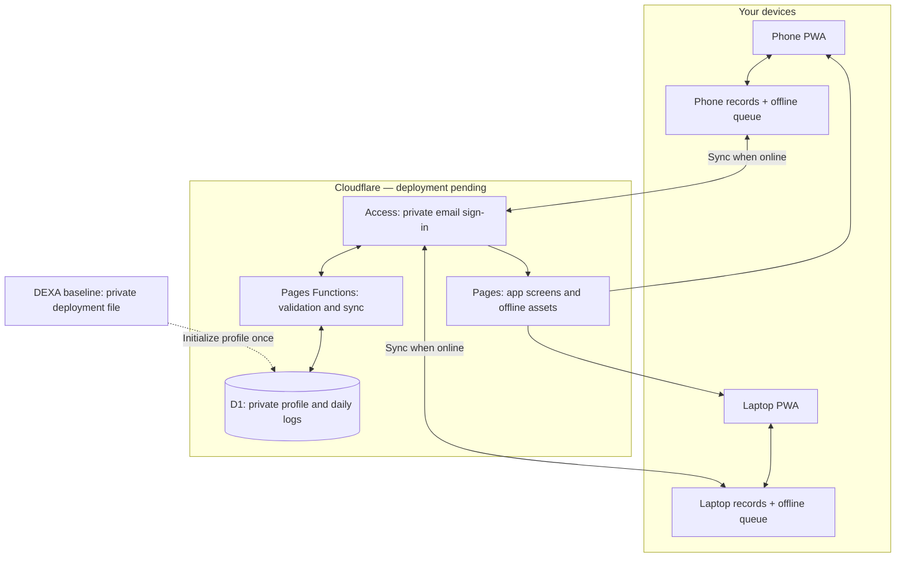
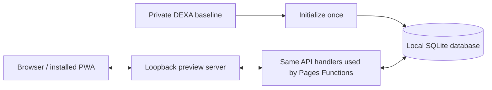

# Gym Buddy architecture

The application is designed for one owner, **Tenzo**, and is built and tested locally. There is no user registration, personal-details intake, account switching or user-management screen. The Cloudflare deployment path below is implemented, but the production database, Access application and domain are not live yet.

## How to read this

1. Sign in using the allowed email. There is no registration questionnaire for body measurements.
2. Pages supplies the same app to your phone and laptop: Today, Food & Water, Movement, Progress, My Plan and Settings.
3. Each device saves entries locally first, including offline. The service worker keeps the app screens available offline after an initial successful load.
4. When the app is open and connected, its queue sends changes through the authenticated API. Functions validate the data and the user's Access token.
5. D1 stores your profile and logs. Successful writes have version numbers and receipts, so a retry does not duplicate a record.
6. Other devices refresh from the same database every 30 seconds while visible, and on return/reconnection. Conflicting edits require choosing which version to keep.

The watch currently has a manual-entry path: watch/Samsung Health → your activity or daily check-in → local queue → D1. There is no automatic Samsung Health connection.

## Your profile, without re-entering measurements

The original DEXA report has already been transcribed into the ignored `.private/dexa-baseline.json`. It is not part of the public frontend or the source archive.

- The local server reads this file and initializes its private local database before serving the app.
- `npm run deploy` reads this file and initializes the configured production D1 owner profile before publishing.
- Initialization creates a profile only if none exists. Later launches and deployments preserve your changes.
- The browser loads your existing profile from storage and opens the dashboard directly. Only daily goals and the workout plan are editable in Settings; the original DEXA baseline is shown read-only.
- Missing cloud configuration or a missing seed is reported as a connection/configuration problem; the app does not ask you to register your statistics again.

Scan measurements remain separate from editable daily targets and your exercise schedule. Unknown measurements, such as waist circumference, remain blank until you log them.

## What runs locally today

The default preview uses `.private/gym-buddy.sqlite` and the owner email in `.private/deployment.json`. Browser testing uses `GYM_BUDDY_TEST_MODE=1`, a synthetic profile, a test-only account, and `.private/browser-tests.sqlite`; it does not edit the owner's measurements.

## Code map

| Part | Source |
| --- | --- |
| Screens, forms, calculators and charts | `public/app.js`, `public/styles.css`, `public/domain.js` |
| Local storage, outbox and conflict handling | `public/store.js` |
| Offline app assets | `public/sw.js`, `public/manifest.webmanifest` |
| Session and record API | `functions/api/[[path]].js` |
| Private sign-in and token verification | `functions/lib/auth.js` |
| Versioned writes and duplicate protection | `functions/lib/records.js`, `migrations/0001_records.sql` |
| Private profile initialization | `scripts/profile.mjs`, `scripts/seed-profile.mjs` |
| Local preview and production publishing | `scripts/dev.mjs`, `scripts/deploy.mjs` |

See [DEPLOY.md](DEPLOY.md) for the remaining Cloudflare account setup.
